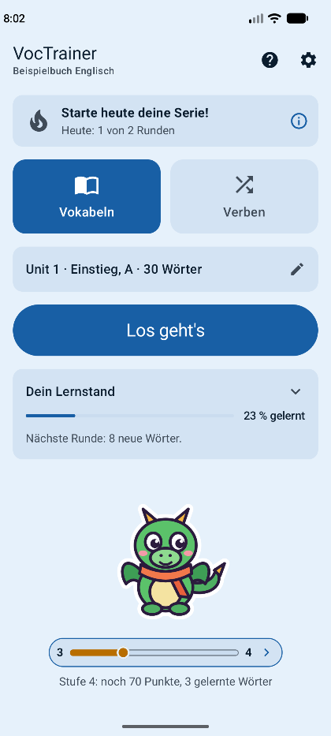
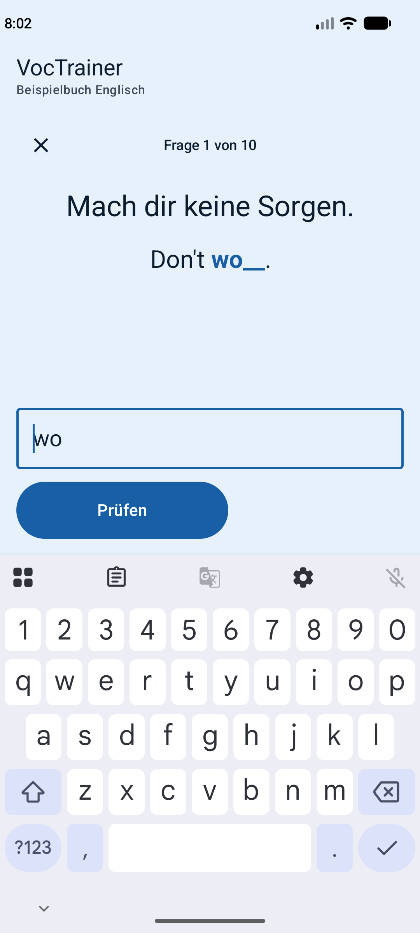
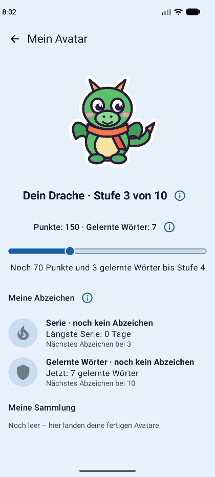

# VocTrainer

VocTrainer is an Android app for learning English vocabulary from a textbook. It works completely offline:
no account, no server and no data collection – everything stays on the device. Words are asked in short
rounds, first with suggested answers and later by typing. Every word climbs through learning levels, and
practising earns points that make an avatar grow, plus badges, a daily goal and a streak. The app itself is
in German.

<p>
  
  
  
</p>

## Installation and user manual

Installation and user manual: see the German user manual [docs/HANDBUCH.md](docs/HANDBUCH.md).

In short: download the APK from the [Releases page](https://github.com/MarkusHornbach/VocTrainer/releases), allow installing apps from that source and
install it; to update, install the new APK over the old one (never uninstall first – that deletes the
learning progress).

## Getting vocabulary in

- A small example book („Beispielbuch Englisch“, 150 words and 36 irregular verbs) is built in, so the app
  can be tried right away.
- Own vocabulary comes in through import files in a documented JSON format, see
  [docs/FILE_FORMATS.md](docs/FILE_FORMATS.md).

## Documentation

| Document | Content |
|---|---|
| [docs/HANDBUCH.md](docs/HANDBUCH.md) | German user manual for learners |
| [docs/FEATURES.md](docs/FEATURES.md) | complete description of what the app does, with exact rules |
| [docs/ROADMAP.md](docs/ROADMAP.md) | planned features |
| [docs/ARCHITECTURE.md](docs/ARCHITECTURE.md) | tech stack, structure, data model, build and tests |
| [docs/FILE_FORMATS.md](docs/FILE_FORMATS.md) | import and backup file formats |
| [docs/TEST_APP.md](docs/TEST_APP.md) | the debug build and its test tools |

## Build

```
./gradlew assembleDebug
```

Details (tests, release build, signing): [docs/ARCHITECTURE.md](docs/ARCHITECTURE.md).

## License and privacy

- License: MIT, see [LICENSE](LICENSE).
- Privacy: the app collects no data and has no internet access, see [PRIVACY.md](PRIVACY.md).
