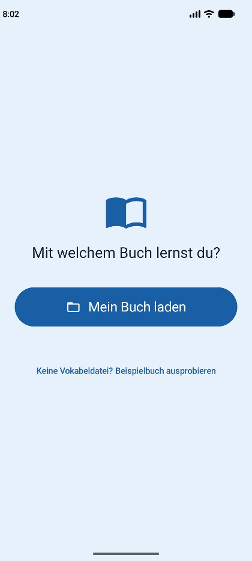
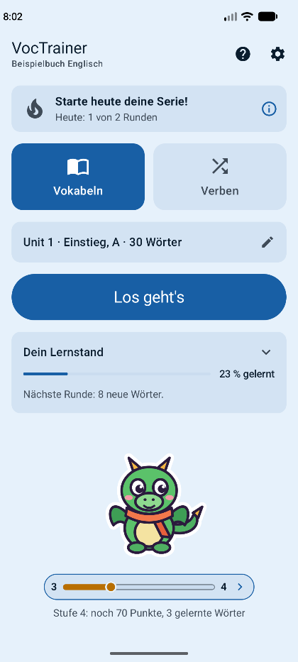
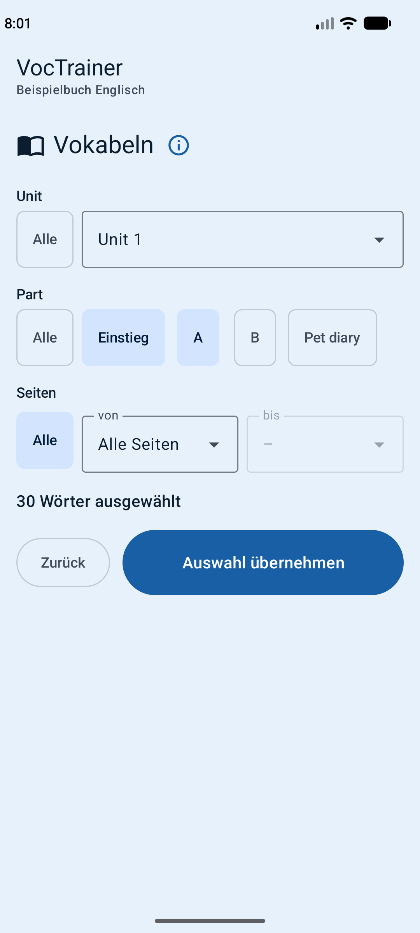
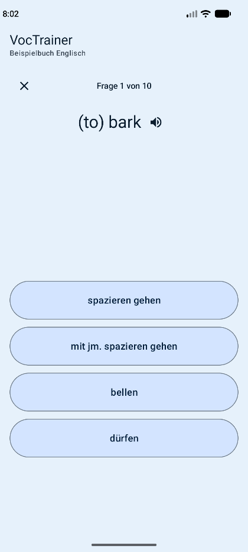
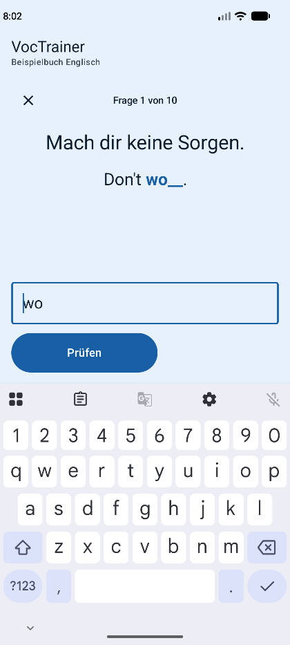
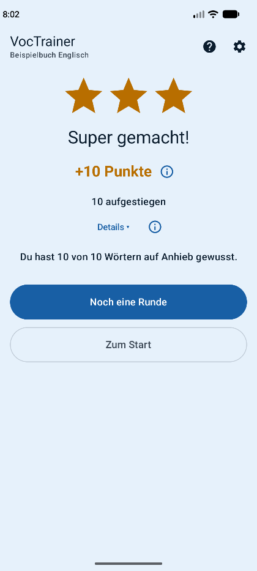
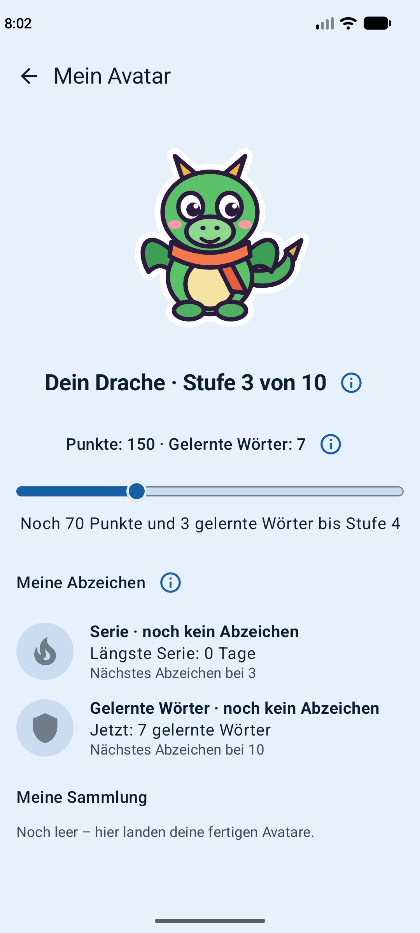

# VocTrainer – Handbuch

Mit VocTrainer lernst du englische Wörter aus deinem Schulbuch. Die App fragt dich die Wörter in kurzen
Runden ab. Für jede Runde bekommst du Punkte, und dein Avatar wächst mit.

Alles bleibt auf deinem Handy. Du brauchst kein Konto und kein Internet zum Üben.

---

## Inhalt

1. [Installation](#1-installation)
   - [App installieren](#app-installieren)
   - [App aktualisieren](#app-aktualisieren)
   - [Wenn die Installation nicht klappt](#wenn-die-installation-nicht-klappt)
2. [Erste Schritte](#2-erste-schritte)
   - [Der erste Start](#der-erste-start)
   - [Die Startseite](#die-startseite)
   - [Hilfe, ⓘ und Tipps](#hilfe--und-tipps)
3. [Wörter in die App holen](#3-wörter-in-die-app-holen)
   - [Eine Vokabeldatei importieren](#eine-vokabeldatei-importieren)
   - [Wörter, die schon da sind](#wörter-die-schon-da-sind)
   - [Mehrere Bücher](#mehrere-bücher)
   - [Buch wechseln](#buch-wechseln)
   - [Das Beispielbuch](#das-beispielbuch)
4. [Üben](#4-üben)
   - [Wörter auswählen](#wörter-auswählen)
   - [Eine Runde](#eine-runde)
   - [Mit Vorschlägen](#mit-vorschlägen)
   - [Tippen](#tippen)
   - [Das Ende der Runde](#das-ende-der-runde)
   - [Neu, am Üben, gelernt, gemeistert](#neu-am-üben-gelernt-gemeistert)
   - [Verben üben](#verben-üben)
   - [Drei Formen üben](#drei-formen-üben)
   - [Vorsprechen](#vorsprechen)
5. [Punkte, Avatar und Abzeichen](#5-punkte-avatar-und-abzeichen)
   - [Punkte](#punkte)
   - [Dein Avatar](#dein-avatar)
   - [Abzeichen](#abzeichen)
   - [Tagesziel und Serie](#tagesziel-und-serie)
   - [Erinnerung](#erinnerung)
6. [Sichern und wiederherstellen](#6-sichern-und-wiederherstellen)
   - [Sicherung speichern](#sicherung-speichern)
   - [Sicherung wiederherstellen](#sicherung-wiederherstellen)
   - [Buch neu beginnen](#buch-neu-beginnen)
   - [Was bleibt und was weg ist](#was-bleibt-und-was-weg-ist)
   - [Automatische Sicherung von Android](#automatische-sicherung-von-android)
7. [Einstellungen](#7-einstellungen)
   - [Vokabeln verwalten](#vokabeln-verwalten)
   - [Farben, Ton & Vibration](#farben-ton--vibration)
   - [Üben](#üben)
   - [Tagesziel & Erinnerung](#tagesziel--erinnerung)
   - [Gut zu wissen](#gut-zu-wissen)

---

## 1. Installation

VocTrainer gibt es nicht im Play Store. Du lädst die App selbst herunter.

### App installieren

1. Öffne auf deinem Handy die Seite **„Releases“** des Projekts auf GitHub:
   <https://github.com/MarkusHornbach/VocTrainer/releases>
2. Dort steht die neueste Version ganz oben.
3. Tippe auf die Datei, die auf **.apk** endet (zum Beispiel `VocTrainer-1.0.0.apk`). Sie wird heruntergeladen.
4. Öffne die Datei, zum Beispiel über die Meldung „Download abgeschlossen“ oder in der App „Dateien“.
5. Android fragt vielleicht, ob du Apps aus dieser Quelle installieren darfst. Tippe auf **Einstellungen**
   und schalte **„Aus dieser Quelle zulassen“** ein. Die Wörter können auf deinem Handy etwas anders heißen.
6. Gehe zurück und tippe auf **Installieren**.

Danach findest du VocTrainer bei deinen Apps.

### App aktualisieren

Wenn es eine neue Version gibt, installierst du sie einfach über die alte:

1. Mach vorher eine Sicherung (siehe [Kapitel 6](#6-sichern-und-wiederherstellen)). Dann bist du auf der
   sicheren Seite.
2. Lade die neue Datei von der Seite [„Releases“](https://github.com/MarkusHornbach/VocTrainer/releases) herunter.
3. Öffne sie und tippe auf **Aktualisieren** oder **Installieren**.

Deine Wörter, Punkte und dein Avatar bleiben dabei erhalten.

> **Wichtig:** Deinstalliere die alte App **nie** vorher. Beim Deinstallieren wird dein ganzer Lernstand
> gelöscht.

### Wenn die Installation nicht klappt

Manche Handys erlauben keine Apps von außerhalb des Play Stores. Das ist zum Beispiel so, wenn der
zusätzliche Schutz von Google (erweiterter Schutz) eingeschaltet ist. Auf so einem Handy kannst du
VocTrainer leider nicht installieren.

---

## 2. Erste Schritte

### Der erste Start

Beim allerersten Start begrüßt dich die App mit **„Willkommen bei VocTrainer!“**.

1. Tippe auf **„Los geht's“**. Kennst du die App schon, tippe auf **„Ohne Tipps starten“**. Dann zeigt
   sie dir keine Tipps (siehe unten).
2. Die App fragt: **„Mit welchem Buch lernst du?“**
   - Hast du eine Vokabeldatei? Tippe auf **„Mein Buch laden“** und wähle die Datei aus.
   - Du hast keine? Tippe auf **„Keine Vokabeldatei? Beispielbuch ausprobieren“**. Dann übst du mit dem
     eingebauten Beispielbuch. Dein eigenes Buch kannst du später laden.
3. Wähle deinen Avatar (siehe [Kapitel 5](#dein-avatar)).

Danach siehst du die Startseite.

Passt die Datei nicht, sagt die App: **„Diese Datei passt nicht. Wähle eine Vokabeldatei.“**
Schließt du die App mitten im ersten Start, beginnt sie beim nächsten Mal wieder mit der Begrüßung.

### Die Startseite

Von oben nach unten siehst du:

| Was | Wofür |
|---|---|
| **VocTrainer** und darunter der Name deines Buchs | Mit diesem Buch übst du gerade. |
| **?** und Zahnrad oben rechts | Hilfe und Einstellungen |
| Die Leiste mit der Flamme | dein Tagesziel und deine Serie ([Kapitel 5](#tagesziel-und-serie)) |
| **„Vokabeln“** und **„Verben“** | Was du üben möchtest: Wörter oder unregelmäßige Verben |
| Die Zeile mit dem Stift | deine Auswahl: welche Wörter du übst ([Kapitel 4](#wörter-auswählen)) |
| **„Los geht's“** | startet eine Runde |
| **„Dein Lernstand“** | wie viele Wörter deiner Auswahl du schon gelernt hast |
| Dein Avatar mit Balken | wie weit er bis zur nächsten Stufe ist |

### Hilfe, ⓘ und Tipps

- **Tipps:** Am Anfang zeigt dir die App ein paar Tipps. Der Bildschirm wird dunkler, nur eine Stelle
  bleibt hell. Daneben steht kurz, was sie macht. Tippe auf **„Verstanden“**, dann kommt dieser Tipp nicht
  wieder. Tippst du nur daneben, kommt er später noch einmal.
- **ⓘ:** Neben vielen Teilen der App steht ein kleines ⓘ. Tippe darauf, dann erklärt dir die App diesen Teil.
- **Hilfe:** Das **?** oben rechts öffnet die Seite **„Hilfe“**. Dort findest du alle Erklärungen der ⓘ
  an einer Stelle.
- Ganz unten auf der Hilfe-Seite holt **„💡 Tipps wieder zeigen“** alle Tipps zurück.

---

## 3. Wörter in die App holen

Die Wörter kommen aus einer **Vokabeldatei**. Ohne Datei kannst du mit dem Beispielbuch üben.

### Eine Vokabeldatei importieren

Wenn du eine Vokabeldatei bekommen hast, speichere sie auf deinem Handy oder in deinem Online-Speicher.
Dann:

1. Tippe oben rechts auf das Zahnrad.
2. Tippe auf **„Vokabeln verwalten“**.
3. Tippe auf **„Vokabeln importieren“**.
4. Wähle die Datei aus.

Die App zeigt dir danach, wie viele Vokabeln dazugekommen sind und wie viele sich geändert haben. Ist die Datei kaputt oder falsch,
wird nichts importiert. Die Meldung sagt dir, woran es liegt.

### Wörter, die schon da sind

Du kannst eine Datei ruhig zweimal importieren:

- Wörter, die es schon gibt, kommen nicht doppelt. Dein Lernstand bei diesen Wörtern bleibt immer.
- Hat sich in der Datei bei einem Wort etwas geändert, zum Beispiel eine Bedeutung oder die Seite, übernimmt
  die App die Änderung.
- Ist ein Wort in der Datei ausgeschlossen, fragt die App es nicht mehr ab. Ist es später wieder dabei,
  kommt es zurück – mit deinem Lernstand.
- Neue Wörter aus der Datei kommen dazu.

Nach neuen Wörtern blinkt auf der Startseite kurz deine Auswahl. So siehst du, wo du sie auswählen kannst.

### Mehrere Bücher

Jede Vokabeldatei gehört zu einem **Buch**. Die App kann mehrere Bücher haben.

- Gehört die Datei zu einem neuen Buch, legt die App das Buch an. Hast du schon ein Buch, fragt sie:
  **„Neues Buch „…“ – jetzt zu diesem Buch wechseln?“** Tippe auf **„Ja“**, wenn du gleich damit üben
  willst. Bei **„Nein“** bleibt dein bisheriges Buch.
- Gehört die Datei zu einem Buch, das du schon hast, kommen die Wörter in dieses Buch.

Jedes Buch hat seinen eigenen Lernstand: Wörter, Level, Punkte, Avatar, Abzeichen und Serie.

### Buch wechseln

1. Tippe auf das Zahnrad und dann auf **„Vokabeln verwalten“**.
2. Unter **„Bücher“** siehst du deine Bücher, zum Beispiel „120 Wörter, 35 gelernt“. Dein aktuelles Buch
   ist mit **„Aktiv“** markiert.
3. Tippe auf ein anderes Buch. Ab jetzt übst du mit diesem Buch.

Beim Wechseln geht nichts verloren. Bücher kannst du nicht löschen.

### Das Beispielbuch

Das **„Beispielbuch Englisch“** ist schon in der App. Es hat 150 Wörter und 36 unregelmäßige Verben
in 3 Units. Damit kannst du alles ausprobieren.

- In der Liste „Bücher“ steht es nur, solange du damit übst.
- Es kommt nie in eine Sicherung. Nach „Sicherung wiederherstellen“ beginnt es wieder von vorn.

---

## 4. Üben

### Wörter auswählen

Deine **Auswahl** sind die Wörter, die du gerade übst. So wählst du sie:

1. Tippe auf der Startseite auf die Zeile mit dem Stift (zum Beispiel „Unit 1 · Einstieg, A · 30 Wörter“).
2. Wähle eine **Unit** aus. Mit **„Alle Units“** übst du das ganze Buch.
3. Bei einer Unit kannst du einen oder mehrere **Parts** antippen. **„Einstieg“** sind die Wörter vom
   Anfang der Unit.
4. Unter **„Seiten“** kannst du mit **„von“** und **„bis“** Seiten wählen. Für eine einzige Seite lässt
   du „bis“ leer.
5. Darunter steht, wie viele Wörter passen, zum Beispiel „30 Wörter ausgewählt“.
6. Tippe auf **„Auswahl übernehmen“**.

Der Knopf **„Alle“** am Anfang jeder Zeile nimmt die Wahl in dieser Zeile wieder weg.
Tippst du auf **„Zurück“**, bleibt die alte Auswahl. Hast du etwas geändert, fragt die App vorher:
**„Deine Auswahl hat sich geändert. Möchtest du sie übernehmen?“**

Die App merkt sich deine Auswahl, auch wenn du sie schließt.

**Beispiel:** Du hast als Hausaufgabe die Seiten 150 bis 152 auf. Wähle Unit 1 und unter „Seiten“
von 150 bis 152.

### Eine Runde

Tippe auf **„Los geht's“**. Eine Runde hat 10 Wörter. Oben steht, bei welcher Frage du bist, zum
Beispiel „Frage 3 von 10“.

- Nur deine **erste Antwort** zählt.
- Wörter, die du falsch hattest, kommen am Ende noch einmal. Oben steht dann **„Wiederholung“**. Sie
  kommen so lange, bis du sie richtig hast. Die Wiederholung bringt keine Punkte und kein Level.
- Willst du aufhören? Tippe oben links auf das **X**. Die App fragt **„Runde abbrechen?“**. Mit
  **„Abbrechen“** hörst du auf, mit **„Weiterspielen“** machst du weiter. Deine Antworten bis dahin
  bleiben gespeichert.

### Mit Vorschlägen

Bei neuen Wörtern gibt dir die App vier Antworten zur Auswahl. Tippe die richtige an.

- Am Anfang siehst du das englische Wort und suchst die deutsche Bedeutung.
- Später ist es umgekehrt: Du siehst das deutsche Wort und suchst das englische.

Nach deiner Antwort steht da **„Richtig!“** oder **„Leider falsch“**.

War es falsch, zeigt dir die App die richtige Antwort. Lies sie dir in Ruhe durch. Dann tippe auf
**„Nochmal versuchen“**. Die vier Antworten kommen in neuer Reihenfolge. Finde jetzt die richtige.
Das Wort zählt trotzdem als falsch und kommt am Ende noch einmal.

### Tippen

Kennst du ein Wort schon besser, schreibst du es selbst. Du siehst das deutsche Wort und darunter
das englische mit einer Lücke. In die Lücke gehört das **Wort zum Tippen**.

1. Tippe das Wort in das Feld. Es erscheint gleich in der Lücke.
2. Tippe auf **„Prüfen“**.

Groß- und Kleinschreibung ist egal. Du darfst auch alles tippen, nicht nur das Wort aus der Lücke.

Was dann passieren kann:

| Die App zeigt | Was es bedeutet | Was du machst |
|---|---|---|
| **„Richtig!“** | Super! | nichts, es geht weiter |
| **„Auch richtig! Gesucht war: …“** | Dein Wort ist auch richtig, die App wollte aber ein anderes. | nichts, es geht weiter |
| **„Fast richtig“** | Ein kleiner Tippfehler, oder du hast amerikanisch geschrieben. Darunter steht der Grund, zum Beispiel **„Kleiner Tippfehler“** oder **„Im Lehrbuch britisch“**. | Tippe das Wort einmal richtig ab. |
| **„Leider falsch“** | Das war nicht das Wort. Darunter steht **„So geht's richtig: …“**. | Tippe das markierte Wort ab. |

**Nicht sicher?** Warte kurz. Dann erscheint neben „Prüfen“ der Knopf **„Mit Vorschlägen“**. Damit
bekommst du vier Antworten zur Auswahl. Aber Achtung: Ist das Wort schon gelernt, steht dabei **„Mit
Vorschlägen: Wort fällt auf ‚am Üben‘ zurück“**. Es zählt dann nicht so viel, wie wenn du es selbst tippst.

### Das Ende der Runde

Am Ende siehst du:

- 0 bis 3 **Sterne**. Je mehr Wörter du beim ersten Versuch wusstest, desto mehr Sterne. Selbst getippte
  Wörter zählen mehr als „Mit Vorschlägen“ oder „Fast richtig“.
- Deine Punkte aus dieser Runde, zum Beispiel „+10 Punkte“.
- Wie viele Wörter aufgestiegen sind.
- **„Details“**: Tippe darauf, dann siehst du jedes Wort der Runde. Ein Pfeil nach oben heißt: Das Wort
  ist ein Level höher. Manchmal steht ein kurzer Grund dabei, zum Beispiel „Aufstieg ab morgen“. Das ⓘ
  daneben erklärt alle Zeichen.
- Wenn dein Avatar gewachsen ist oder du ein Abzeichen bekommen hast, steht das auch hier.

Mit **„Noch eine Runde“** übst du weiter. **„Zum Start“** bringt dich zur Startseite.

### Neu, am Üben, gelernt, gemeistert

Jedes Wort hat ein **Level** von 0 bis 5. Ist deine erste Antwort richtig, steigt es ein Level. Ist sie
falsch, geht es ein Level zurück.

| Level | So heißt es | So wirst du gefragt |
|---|---|---|
| 0 | **neu** | englisches Wort, du wählst das deutsche |
| 1 | **am Üben** | englisches Wort, du wählst das deutsche |
| 2 | **am Üben** | deutsches Wort, du wählst das englische |
| 3 | **am Üben** | deutsches Wort, du tippst das englische |
| 4 | **gelernt** | du tippst |
| 5 | **gemeistert** | du tippst |

Gut zu wissen:

- **Gelernt** und **gemeistert** wird ein Wort nur, wenn du es selbst tippst.
- **Gelernt** wird ein Wort erst, wenn du es an einem späteren Tag noch richtig tippst. **Gemeistert**
  wird es, wenn du es nach längerer Zeit noch weißt. Übe also lieber jeden Tag ein bisschen.
- Wörter, die du schon kannst, fragt die App später noch einmal ab. So vergisst du sie nicht.

**Dein Lernstand:** Die Karte „Dein Lernstand“ auf der Startseite zeigt, wie viel Prozent deiner Auswahl
du schon gelernt hast. Darunter steht, was die nächste Runde bringt, zum Beispiel **„Nächste Runde: 3 Wörter
kannst du fertig lernen.“** Tippe auf die Karte. Dann siehst du, wie viele Wörter auf welchem Level sind.
Das ⓘ erklärt die Level noch einmal.

### Verben üben

Tippe auf der Startseite auf **„Verben“**. Jetzt übst du unregelmäßige Verben.

- Du siehst ein Verb, zum Beispiel „(to) go“. Die App fragt: **„Wie lautet das simple past?“**
- Du wählst immer aus vier Antworten.
- Manchmal kommt auch ein regelmäßiges Verb dazu. Deshalb kann eine Runde 12 Fragen haben.
- Für Verben wählst du eine eigene Auswahl, genau wie bei den Vokabeln.
- Verben bringen keine Punkte und zählen nicht für dein Tagesziel.

Steht da **„Noch keine Verben da.“**, dann hat dein Buch noch keine Verben.

Lernst du schon drei Formen, zum Beispiel „go – went – gone“? Dann stell es um
([Drei Formen üben](#drei-formen-üben)).

### Drei Formen üben

Unter **Einstellungen → „Üben“** wählst du bei **„Verbformen“**:

| Auswahl | Was du übst |
|---|---|
| **„2 Formen (go – went)“** | nur das Simple Past (so startet die App) |
| **„3 Formen (go – went – gone)“** | erst das Simple Past, dann das Past Participle |

So geht eine Frage mit drei Formen:

1. Die App fragt: **„Wie lauten die Formen?“** Darunter stehen zwei Zeilen: „simple past ?“ und
   „past participle ?“.
2. Wähle zuerst das Simple Past. Ist es richtig, steht es danach in seiner Zeile.
3. Dann kommen vier neue Antworten. Wähle jetzt das Past Participle.

- Das Verb ist nur richtig, wenn **beide** Antworten beim ersten Versuch stimmen. Dann steigt es ein Level.
- War das Simple Past falsch, findest du es mit **„Nochmal versuchen“**. Danach kommt trotzdem das Past
  Participle. Ist das richtig, steht da **„Das Simple Past war noch nicht richtig.“**
- Falsche Verben übst du am Ende der Runde noch einmal, mit beiden Formen.
- Verben ohne dritte Form im Buch kommen bei „3 Formen“ nicht dran. Sie zählen dann auch nicht in
  „Dein Lernstand“.
- Mit Vorsprechen hörst du nach der zweiten Antwort alle drei Formen, zum Beispiel „go – went – gone“.
- Deine Level bleiben gleich, wenn du umstellst.

Steht da **„Bei deinen Verben fehlt noch die dritte Form.“**, dann hat kein Verb in deinem Buch eine
dritte Form. Stell dann auf „2 Formen“ zurück.

### Vorsprechen

Tippe auf den Lautsprecher neben dem englischen Wort, dann liest die App es dir vor. Fragt die App auf
Deutsch, gibt es den Lautsprecher erst nach deiner Antwort. Hörst du nichts? Mach dein Handy lauter.
Automatisch vorlesen kannst du in den Einstellungen einschalten ([Kapitel 7](#farben-ton--vibration)).

---

## 5. Punkte, Avatar und Abzeichen

### Punkte

| Wofür | Punkte |
|---|---|
| Ein Wort erreicht zum ersten Mal ein Level | so viele wie das Level (Level 3 = 3 Punkte) |
| Ein gemeistertes Wort weißt du nach längerer Zeit noch | 5 |
| Du schaffst dein Tagesziel | Bonuspunkte – je länger deine Serie, desto mehr |
| Falsche Antworten, Wiederholungen, „Nochmal versuchen“, „Fast richtig“, Verben | 0 |

Erreicht ein Wort ein Level, das es schon einmal hatte, gibt es keine Punkte mehr.
Punkte verlierst du nie. Nur „Buch neu beginnen“ setzt sie auf 0.
Alle deine Punkte siehst du auf der Seite **„Mein Avatar“**.

### Dein Avatar

Dein **Avatar** wächst, während du lernst. Es gibt drei Arten:

- **„Drache“** und **„Monster“** starten als Ei.
- **„Kämpfer“** startet als Rekrut.

**Avatar wählen:** Tippe auf eine Art und bestätige mit **„Ja“**. Die Wahl gilt, bis dein Avatar
ausgewachsen ist. Jedes Buch hat seinen eigenen Avatar.

**So wächst er:**

- Dein Avatar hat 10 Stufen.
- Für jede Stufe braucht er Punkte. Ab Stufe 3 braucht er auch **gelernte Wörter**.
- Eine Stufe, die er erreicht hat, verliert er nie wieder.
- Unter dem Avatar auf der Startseite zeigt ein Balken, wie weit es noch ist. Darunter steht, was noch
  fehlt, zum Beispiel „Stufe 4: noch 70 Punkte, 3 gelernte Wörter“.
- Ein kleines Schloss am Balken heißt: Die Punkte reichen schon, es fehlen nur noch gelernte Wörter.

Tippe auf deinen Avatar, dann öffnet sich **„Mein Avatar“**. Dort siehst du deine Punkte, deine gelernten
Wörter, deine Abzeichen und deine fertigen Avatare. Tippe auf das ⓘ neben der Stufe, dann zeigt dir die
App, was jede Stufe braucht.

**Fertig ausgewachsen:** Bei Stufe 10 ist dein Avatar fertig. Er kommt in **„Meine Sammlung“**. Dann
wählst du einen neuen Avatar. Jeder neue Avatar braucht neue gelernte Wörter.

### Abzeichen

Abzeichen sind eine kleine Belohnung dazu. Es gibt zwei Reihen mit je vier Stufen:

| Abzeichen | Was zählt | Bronze | Silber | Gold | Platin |
|---|---|---|---|---|---|
| **„Serie“** | deine längste Serie in Tagen | 3 | 7 | 30 | 100 |
| **„Gelernte Wörter“** | Wörter, die gerade gelernt oder gemeistert sind | 10 | 50 | 150 | 500 |

Ein Abzeichen behältst du für immer. Nur „Buch neu beginnen“ nimmt es weg. Abzeichen bringen keine Punkte.
Du findest sie auf „Mein Avatar“ unter **„Meine Abzeichen“**.

### Tagesziel und Serie

- **Tagesziel:** So viele Runden möchtest du am Tag schaffen (2 bis 5). Nur fertige Vokabelrunden
  zählen, keine Verben und keine abgebrochenen Runden.
- **Serie:** So viele Tage hintereinander hast du dein Tagesziel geschafft.
- **Joker:** Einen Tag pro Woche darfst du auslassen. Der Joker rettet deine Serie dann von selbst.
  In der Leiste siehst du dafür ein Schild.

Die Leiste oben auf der Startseite zeigt zum Beispiel „5 Tage“ und „Heute: 1 von 2 Runden“. Hast du noch keine
Serie, steht dort **„Starte heute deine Serie!“**. Tippe auf die Leiste, dann erklärt dir die App alles
zu deiner Serie.

### Erinnerung

Die App erinnert dich jeden Tag ans Üben, am Anfang um 17 Uhr. Das passiert nur, wenn dein Tagesziel noch fehlt.
Tippe auf die Nachricht, dann öffnet sich die App.

Beim ersten Mal fragt Android, ob die App dir Nachrichten schicken darf. Sagst du nein, ist die
Erinnerung aus. Die Uhrzeit änderst du in den Einstellungen ([Kapitel 7](#tagesziel--erinnerung)).

---

## 6. Sichern und wiederherstellen

Eine **Sicherung** ist eine Datei mit deinem ganzen Lernstand. Damit kannst du:

- deinen Lernstand auf ein neues Handy mitnehmen,
- zu einem alten Stand zurückgehen, wenn etwas schiefgegangen ist.

### Sicherung speichern

1. Tippe auf das Zahnrad und dann auf **„Vokabeln verwalten“**.
2. Tippe auf **„Sicherung exportieren“**.
3. Wähle einen Ort, zum Beispiel deinen Online-Speicher. Der Dateiname beginnt mit dem Datum.
4. Tippe auf **Speichern**.

Mach regelmäßig eine Sicherung und immer, bevor du die App aktualisierst.

### Sicherung wiederherstellen

1. Tippe auf das Zahnrad und dann auf **„Vokabeln verwalten“**.
2. Tippe auf **„Sicherung wiederherstellen“** und wähle die Datei.
3. Die App zeigt, was in der Sicherung steckt (**„Die Sicherung enthält:“** und deine Bücher).
   Prüfe, ob es die richtige Datei ist.
4. Tippe auf **„Wiederherstellen“**. Mit **„Abbrechen“** ändert sich nichts.

Danach ist alles genau so wie beim Speichern der Sicherung. Was du danach geübt hast, ist weg.

Kommt die Meldung **„Die Datei stammt aus einer neueren App-Version. Bitte die App aktualisieren.“**,
installiere zuerst die neue Version der App (siehe [Kapitel 1](#app-aktualisieren)).

### Buch neu beginnen

Mit **„Buch neu beginnen“** fängst du dein aktuelles Buch noch einmal ganz von vorn an.

1. Tippe auf das Zahnrad und dann auf **„Vokabeln verwalten“**.
2. Ganz unten unter **„Lernstand zurücksetzen“** tippe auf **„Buch neu beginnen“**.
3. Die App erklärt, was zurückgesetzt wird. Tippe auf **„Sicherung speichern“** und speichere die Datei.
4. Die App fragt: **„Wirklich neu beginnen?“** Tippe auf **„Endgültig neu beginnen“**.

Mit **„Abbrechen“** passiert nichts. Hebe die Sicherung gut auf: Nur damit bekommst du den alten Stand
zurück. Beim Beispielbuch gibt es keine Sicherung, da fragt die App nur einmal.

Gibt es noch nichts zum Zurücksetzen, steht dort **„In diesem Buch gibt es noch nichts zurückzusetzen.“**

### Was bleibt und was weg ist

| | Sicherung wiederherstellen | Buch neu beginnen |
|---|---|---|
| Wörter und Verben | wie in der Sicherung | bleiben, aber alle wieder „neu“ |
| Punkte, Abzeichen, Serie | wie in der Sicherung | auf 0 |
| Wachsender Avatar | wie in der Sicherung | weg, du wählst einen neuen |
| Fertige Avatare („Meine Sammlung“) | wie in der Sicherung | bleiben |
| Andere Bücher | wie in der Sicherung | bleiben |
| Einstellungen | wie in der Sicherung | bleiben |
| Beispielbuch | beginnt von vorn | – |

### Automatische Sicherung von Android

Ist bei deinem Google-Konto die Sicherung eingeschaltet, sichert Android die App-Daten auch selbst.
Nach einem neuen Handy kann dein Lernstand so zurückkommen. Verlass dich aber nicht nur darauf: Eine
eigene Sicherung ist sicherer.

---

## 7. Einstellungen

Tippe oben rechts auf das Zahnrad. Die **„Einstellungen“** haben vier Bereiche. Während einer Runde
ist das Zahnrad ausgeblendet.

### Vokabeln verwalten

Hier findest du:

| Bereich | Knöpfe | Mehr dazu |
|---|---|---|
| **„Bücher“** | deine Bücher, **„Vokabeln importieren“** | [Kapitel 3](#3-wörter-in-die-app-holen) |
| **„Sicherung“** | **„Sicherung exportieren“**, **„Sicherung wiederherstellen“** | [Kapitel 6](#6-sichern-und-wiederherstellen) |
| **„Lernstand zurücksetzen“** | **„Buch neu beginnen“** | [Kapitel 6](#buch-neu-beginnen) |

### Farben, Ton & Vibration

- **„Farben“:** **„Gaming dunkel“** (immer dunkel), **„Ozean“** (blau, so startet die App) oder
  **„Sonnig“** (orange). „Ozean“ und „Sonnig“ werden dunkel, wenn dein Handy dunkel eingestellt ist.
- **„Wörter automatisch vorsprechen“:** Die App liest englische Wörter von selbst vor. Am Anfang ist das aus.
- **„Vibration bei falschen Antworten“:** Das Handy vibriert bei einer falschen Antwort. Am Anfang ist das aus.

Steht dort **„Auf diesem Gerät ist keine englische Stimme installiert.“**, tippe auf
**„Stimme installieren“**. Lade dort eine englische Stimme herunter und komm zurück in die App.

### Üben

- **„Verbformen“:** **„2 Formen (go – went)“** oder **„3 Formen (go – went – gone)“**. Am Anfang sind es
  2 Formen. Mehr dazu in [Drei Formen üben](#drei-formen-üben).

### Tagesziel & Erinnerung

- **„Tagesziel“:** Tippe an, wie viele Runden du am Tag schaffen möchtest (2 bis 5).
- **„Tägliche Erinnerung“:** schaltet die Erinnerung ein oder aus.
- **„Uhrzeit“:** Tippe auf die Zeit, um sie zu ändern.

Steht dort **„Benachrichtigungen sind für die App blockiert. Du kannst sie in den Android-Einstellungen
erlauben.“**, dann erlaube die Benachrichtigungen für VocTrainer in den Einstellungen deines Handys.

### Gut zu wissen

- Die Einstellungen gelten für alle Bücher. Sie sind auch in deiner Sicherung.
- Die App sieht immer gleich groß aus, auch wenn du die Schrift auf deinem Handy größer stellst.
- Ganz unten steht die Version der App, zum Beispiel „Version 1.0.0“.

---

Wer selbst Vokabeldateien erstellen möchte, findet das Format in [`docs/FILE_FORMATS.md`](FILE_FORMATS.md).
